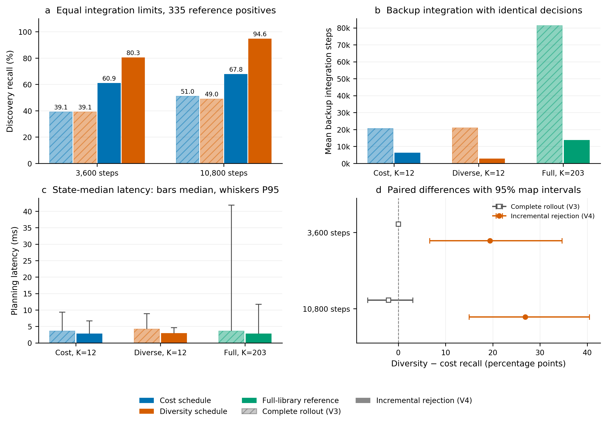
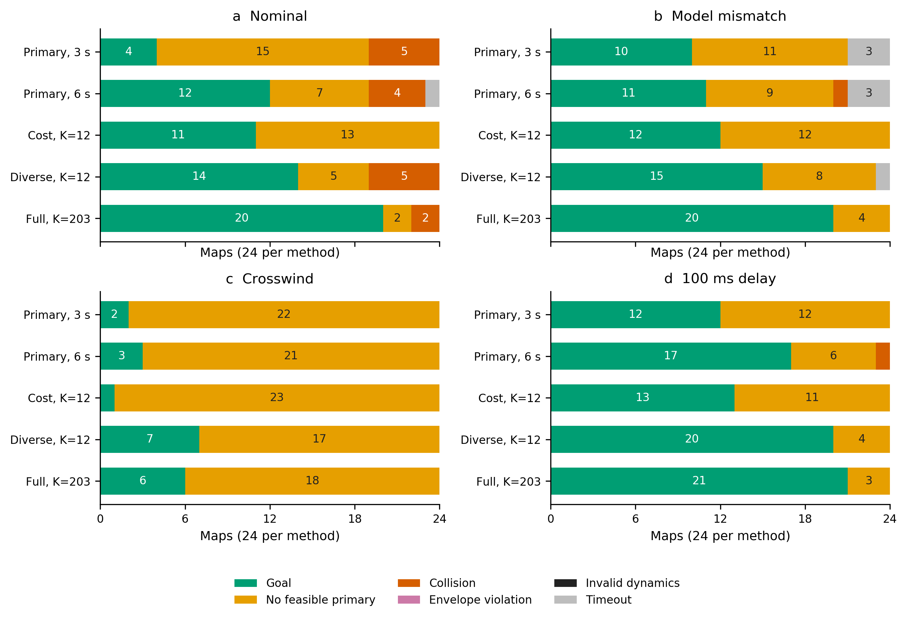

# 最终方法、实验结果与复现

英文论文稿：**[Maneuver-Diverse Terminal Continuation Search for Fixed-Wing Local Motion Planning](../../paper/main.pdf)**。对应 [LaTeX 源码](../../paper/main.tex)、[V3 分析数据](v3/recovery_v3_analysis.json) 和 [V4 补充分析数据](v4/recovery_v4_analysis.json)。

## 方法

本工作研究固定计算预算下的后续机动发现。主轨迹采用原有三维运动基元及飞行动力学预测；候选先通过碰撞、速度、姿态、飞行高度和已知区域检查，再从其完整终态验证后续控制。

最终方法由两个部分组成：

1. **按机动覆盖分配候选预算。** 保留原代价最低的候选，其余名额使用最远点增量采样，覆盖不同终态航向和相对高度。归一化尺度来自空速、主时域与转弯/爬升限制，避免把狭窄高度带中的微小差异放大成主要覆盖维度。在完成验证的候选中选择原代价最低者。
2. **逐采样拒绝。** 后续轨迹一旦出现明确的采样约束违规，即终止该条积分。完整可行轨迹继续积分到后续时域终点，保持原数值更新和完整见证判据。候选数上限与实际积分步上限均可独立配置，预算截断与约束拒绝分开记录。

主实验采用 29 个航向 × 7 个高度层、15 个后续控制、3 s 主时域、6 s 后续时域和 0.02 s 预测积分步长。终端续飞验证是对有限控制库和有限时域的检验；执行闭环每 0.2 s 根据实际状态重新规划。缓存余段重验作为独立可选模块保留，主实验关闭。

## 实验规模与对照

| 项目 | 设置 |
| --- | --- |
| 地图 | 4 类几何场景，每类 6 个固定种子，共 24 张 |
| 闭环执行条件 | 名义 RK4、执行器/升阻力模型偏差、1 m/s 横风、100 ms 控制延迟 |
| 闭环方法 | 同约束主时域 3 s、同约束主时域 6 s、代价 K=12、多样性 K=12、完整库 K=203 |
| 不同闭环配置 | 24 × 4 × 5 = **480**；每方法 96 项 |
| 匹配输入 | 24 地图 × 3 纵向位置 × 3 横向位置 × 2 航向 = **432 状态** |
| 每种验证器的匹配记录 | 432 × 7 方法 × 2 次计时 = **6,048 行** |
| 工作预算 | 后续积分上限 3,600 或 10,800 步；记录实际消耗 |
| 测试 | **55 项通过**：19 项原几何/运动测试、31 项续飞与预算测试、5 项独立执行积分测试 |

执行模型使用单独实现的 RK4 积分，步长 0.005 s。主任务采用完整配置地图；有限观测半径另在诊断实验中分析。计时重复先在状态—方法内部合并，置信区间以 24 张地图为成组重采样单位。相同工作上限不意味着每次调用都消耗相同步数。

## 续飞发现与计算量

完整库在 432 个状态中的 335 个找到可行后续控制。以下发现率均以这 **335 个参考阳性状态**为分母。

| 验证器与预算 | 代价顺序 | 多样性顺序 |
| --- | ---: | ---: |
| 完整积分，K=12 | 239/335，71.34% | 317/335，94.63% |
| 逐采样拒绝，K=12 | 239/335，71.34% | 317/335，94.63% |
| 完整积分，W=3,600 | 131/335，39.10% | 131/335，39.10% |
| 逐采样拒绝，W=3,600 | 204/335，60.90% | 269/335，80.30% |
| 完整积分，W=10,800 | 171/335，51.04% | 164/335，48.96% |
| 逐采样拒绝，W=10,800 | 227/335，67.76% | 317/335，94.63% |

V3 首先表明，单独改变候选顺序能改善 K=12 的发现率，但在较紧的积分工作上限下并未带来同样收益：3,600 步时两者持平，10,800 步时多样性顺序略低。V4 随后在相同地图、状态与预算上加入逐采样拒绝，减少已经失败的后续轨迹所占用的积分工作，得到表中的固定工作预算改进。

对多样性 K=12，平均后续积分步数从 **21,053.81** 降至 **2,653.86**，减少 **87.39%**。这一比例只指后续积分，主候选生成和检查仍计入总规划工作。相同 K 的代价顺序、多样性顺序和完整库在两版验证器之间，发现结果、选中排名和代价均无差异。



## 闭环任务结果

| 方法 | 到达目标 | 无可行主轨迹 | 膨胀障碍边界侵入 | 超时 |
| --- | ---: | ---: | ---: | ---: |
| 同约束主时域 3 s | 28 | 60 | 5 | 3 |
| 同约束主时域 6 s | 43 | 43 | 6 | 4 |
| 代价 K=12 | 37 | 59 | 0 | 0 |
| 多样性 K=12 | 56 | 34 | 5 | 1 |
| 完整库 K=203 | 67 | 27 | 2 | 0 |

每行合计 96 项；这组运行没有额外的飞行包线违规或无效动力学终止。多样性 K=12 的任务完成率为 **58.33%**，代价 K=12 为 **38.54%**，完整库为 **69.79%**。

多样性方法的 5 次边界侵入均出现在名义 RK4 执行条件。日志中的 `collision` 按膨胀后的规划障碍判定；这 5 次运行在首次裕量违规检测时记录的原始障碍最小净空为 **1.57–2.43 m**，因此它们记录的是规划裕量侵入，不能等同于物理接触。完成率和裕量侵入同时报告，反映有限库选择与实际执行之间的差别。

V4 又重放了同一组 480 项闭环配置。对比全部 27,771 条路径记录和 27,291 条决策记录，任务结果、状态路径及相关决策值完全一致。该重放用于验证两种验证器的实现等价性，不与原任务合并计算样本量。



## 复现命令

以下命令在**包含当前仓库的 catkin 工作区根目录**执行。运行计时实验时保持 Gazebo 和编译任务关闭，将新输出放入单独目录。

```bash
source /opt/ros/noetic/setup.bash
catkin_make -j2 -DCATKIN_WHITELIST_PACKAGES="motion_primitives_planning;simple_airplane_plugins;simple_airplane_gazebo;simple_airplane_description"
source devel/setup.bash
catkin_make motion_primitives_3d_test terminal_recovery_test evaluation_plant_test -j2
rostest motion_primitives_planning motion_primitives_3d.test
rostest motion_primitives_planning terminal_recovery.test
rostest motion_primitives_planning evaluation_plant.test
```

运行完整 V3，包括分析程序要求的诊断记录：

```bash
repro_dir="$PWD/recovery_reproduction"
mkdir -p "$repro_dir"
roslaunch motion_primitives_planning recovery_benchmark_v3.launch \
  output_prefix:="$repro_dir/recovery_v3" phase:=all stop_on_rejection:=false
```

运行 V4 匹配输入和闭环等价性重放。两次调用使用同一个 V4 前缀；也可用 `phase:=all` 一次完成。

```bash
roslaunch motion_primitives_planning recovery_benchmark_v3.launch \
  output_prefix:="$repro_dir/recovery_v4" phase:=matched stop_on_rejection:=true
roslaunch motion_primitives_planning recovery_benchmark_v3.launch \
  output_prefix:="$repro_dir/recovery_v4" phase:=episodes stop_on_rejection:=true
```

分析程序需要 NumPy 和 Matplotlib。V3 分析检查完整的 episodes、plans、paths、matched、scenarios 和 diagnostic 输入；V4 分析比较两版 matched 数据，并在 V4 episodes 存在时检查完整的闭环等价性重放。

```bash
planner_pkg="$(rospack find motion_primitives_planning)"
python3 "$planner_pkg/scripts/analyze_recovery_v3.py" \
  "$repro_dir/recovery_v3" --output-dir "$repro_dir/report_v3"
python3 "$planner_pkg/scripts/analyze_recovery_v4.py" \
  "$repro_dir/recovery_v3" "$repro_dir/recovery_v4" \
  --output-dir "$repro_dir/report_v4"
```

Gazebo/RViz 演示使用推荐入口：

```bash
roslaunch motion_primitives_planning terminal_recovery_v3.launch paused:=false
```

入口默认启用多样性 K=12、6 s 后续时域和逐采样拒绝；缓存复用默认关闭。参数 `max_backup_integration_steps:=0` 表示不额外限制后续积分总步数，候选数上限仍生效。验证预算耗尽与没有在完整候选库中找到后续控制是不同状态，均写入 `planning_status`。

## 来源与研究范围

研究代码以 [HKPolyU-UAV/Two-phase-motion-planning](https://github.com/HKPolyU-UAV/Two-phase-motion-planning) 的 `ccb6005c73992214a86cc0cff4fe648f1443a119` 为基线，继承其三维运动基元、执行器响应、代价及几何检查。本研究采用这份公开局部实现，在相同代码和约束上比较主时域消融、候选顺序与完整基元库搜索；相关两阶段规划论文与实现版本分别注明来源。本文研究确定性的候选验证效率，没有训练神经网络。

后续研究将围绕执行裕量侵入开展连续路径检查、模型残差与控制延迟分析，并扩展真实观测遮挡、动态障碍和更完整的飞行动力学验证。在这些共同基线建立后，再评估学习候选生成是否能进一步改善相同实际工作预算下的续飞发现与闭环完成率。

历史结果保持原样：[V1](README.md)、[V2](V2.md)、[V3 冻结协议](V3_PROTOCOL.md)、[V4 补充协议](V4_PROTOCOL.md)。
