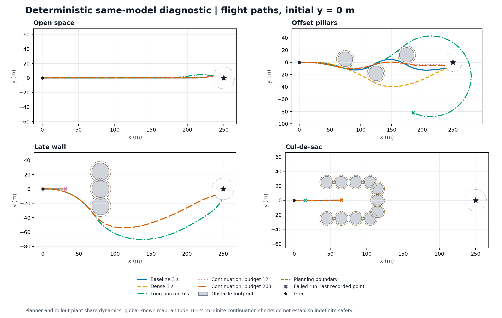
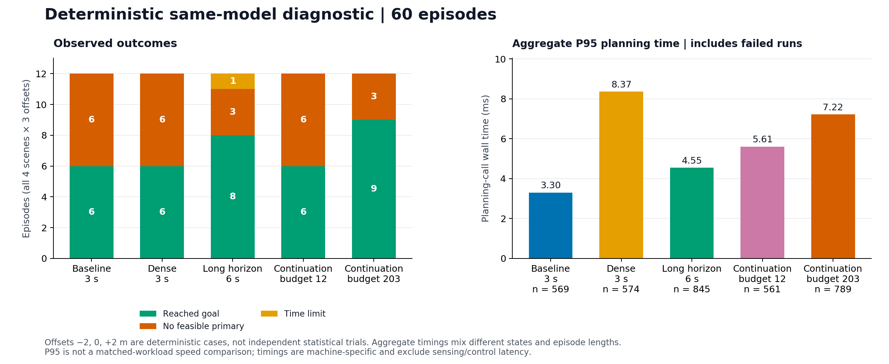

# 第一轮仿真记录（2026-10-30，Asia/Shanghai）

测试范围：Ubuntu 20.04 / ROS Noetic / GCC 8.4.0，Intel Core i5-12400F，默认 `-O2`。原有19项测试和新增9项测试全部通过。以下是完整60回合的同模型闭环诊断；不是随机独立样本，也不是论文级性能结论。

最终耗时在终止所有本任务 Gazebo 进程后重跑采集；两次完整60回合的结局与执行步数逐行一致。

| 方法 | 完成 / 12 | 无可行主段 | 超时 | 平均选择耗时 ms | P95 ms | P99 ms |
|---|---:|---:|---:|---:|---:|---:|
| baseline_3s | 6 | 6 | 0 | 1.98 | 3.30 | 3.50 |
| dense_3s | 6 | 6 | 0 | 5.04 | 8.37 | 8.64 |
| long_6s | 8 | 3 | 1 | 3.84 | 4.55 | 6.17 |
| recovery_3plus3s | 6 | 6 | 0 | 2.49 | 5.61 | 6.00 |
| recovery_full | 9 | 3 | 0 | 2.90 | 7.22 | 19.46 |

计时汇总包含失败回合；不同方法走过的状态、回合长度与场景构成不同，因此表中耗时不能用作逐状态算法加速比。未模拟计算延迟。完整原始数据在 [results/](results/)。

## 可以支持的观察

- 开放空间三种初始偏移，五种方法均完成。
- 错列柱体：原方法、密采样、两种后续检查均完成三回合；6秒单段有一回合在30秒内未到达。完整后续检查并不等价于单纯延长一条常值控制段。
- 横向墙体：原方法、密采样、12候选后续检查均进入无可行主段；6秒单段和完整后续检查完成三回合。
- 死胡同：五种方法全部失败。当前有限后续时域没有解决一般死路或长期可恢复性问题。
- 12候选版本共72个周期耗尽候选预算；完整版本检查上限203，完成数从6/12变为9/12。它给下一步的多方向候选排序、验证预算分配提供了明确动机，但还没有证明学习方法会有效。

## 不能支持的结论

本实验不证明形式化安全、统计显著性、真实飞行可靠性、未知环境适应性或优于原论文完整算法。没有神经网络、真实传感器FOV、长期安全盘旋策略、独立模型扰动和延迟实验。所有失败保留在CSV中，没有删除失败样本来计算成功率。

## 文件

- [回合结局](results/recovery_episodes.csv)
- [每次规划耗时与状态](results/recovery_plans.csv)
- [实际积分轨迹](results/recovery_paths.csv)
- [场景几何](results/recovery_scenarios.csv)
- [机器可读统计](results/recovery_summary.json)
- [源文件校验与运行设置](results/manifest.json)

复现命令、参数与限制见[实现说明](README.md)。

## Gazebo 集成冒烟检查

在最终代码与默认203候选配置下，观察8秒墙钟时间，收到400条里程计与80条规划状态，状态计数为 `{'RECOVERY_VERIFIED': 80}`，规划状态发布约9.97 Hz。飞机位置持续变化，ROS命令与模拟器接口已连通。该检查没有证明整个航线完成或全程无碰撞；记录见[smoke JSON](results/gazebo_smoke_summary.json)。

## 轨迹与统计图

