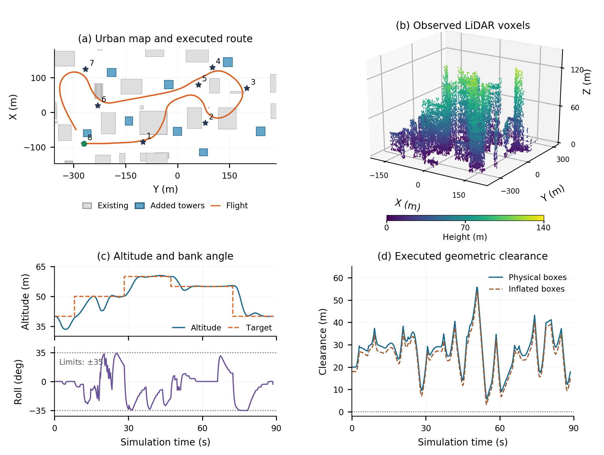

# 城市航点更新与图 8

本次按 Gazebo 世界坐标 `(X,Y)` 修改第 2–5 点，保留各点原高度，其余航点、建筑、动力学、网络及规划参数不变。图 8 的平面图沿用横轴 Y、纵轴 X 的显示方向。

| 航点 | X (m) | Y (m) | 高度 (m) |
| --- | ---: | ---: | ---: |
| 1 | -85 | -100 | 40 |
| **2** | **-30** | **80** | 50 |
| **3** | **70** | **200** | 60 |
| **4** | **130** | **100** | 60 |
| **5** | **80** | **60** | 60 |
| 6 | 20 | -230 | 55 |
| 7 | 125 | -265 | 55 |
| 8 | -90 | -270 | 40 |

`task_end_city.yaml` 与 `task_end_city_dense.yaml` 已同步；场景导入器的默认航点也已更新。完整配置比较及四个新航点的几何检查见 [CHANGE_RECORD.json](CHANGE_RECORD.json)。

## 新路线实测

使用与原图 8 相同的 reference Geometry 网络、406 个控制候选、3 s 主时域、6 s 延续时域及 K=12；水平到点门限 48.825 m，高度容差 3 m。一次独立 Gazebo 运行同时记录真实执行状态与机载雷达回波。

| 项目 | 结果 |
| --- | ---: |
| 完成八航点循环的仿真时刻 | 88.544 s |
| 最后一条里程计时刻 | 88.608 s |
| 航点切换检查 | 8/8 通过 |
| RECOVERY_VERIFIED 更新 | 883 |
| 无可行主轨迹 / 物理盒侵入 / 裕量侵入 | 0 / 0 / 0 |
| 最小物理盒 / 膨胀盒净空 | 5.705 / 3.226 m |
| 最大绝对滚转 / 航迹倾角 | 34.999° / 16.502° |
| 最后保存的 2 m 体素数 | 151,666 |
| 最后体素图时刻 | 87.208 s |
| 原始 / 世界坐标扫描帧 | 442 / 442 |

净空为采样飞机参考点到建筑包围盒的距离。完成航点以原水平与高度门限判定。规划读取已知建筑盒；图中体素来自实际 Gazebo 雷达扫描。



原始数据见 [evidence/flight1](evidence/flight1)，图像来源及数值摘要见 [paper_figure_data.json](paper_figure_data.json)。旧图、旧航迹和十五组城市配置试验保持原记录；论文图 7 的原生窗口截图也保留原路线。图 8 和对应正文使用本次新航线。

## 运行与重绘

加载 ROS 和工作空间后，原密集城区入口直接采用新航点：

```bash
roslaunch motion_primitives_planning terminal_recovery_end_world_dense_lidar.launch paused:=false
```

在仓库根目录记录一次独立运行（输出目录须为空）：

```bash
python3 motion_primitives_planning/scripts/run_city_waypoint_update.py \
  --output /tmp/city_waypoint_run --scratch /tmp/city_waypoint_logs
```

重绘当前论文图 8：

```bash
python3 paper/create_gazebo_figure.py \
  --evidence docs/recovery/city_waypoint_update/evidence/flight1 \
  --output-stem paper/figures/gazebo_city_updated \
  --summary docs/recovery/city_waypoint_update/paper_figure_data.json
```

`create_gazebo_figure.py` 不带参数仍重绘旧采集记录；审稿城市对照脚本默认读取冻结的原路线，避免新配置影响旧实验复现。
