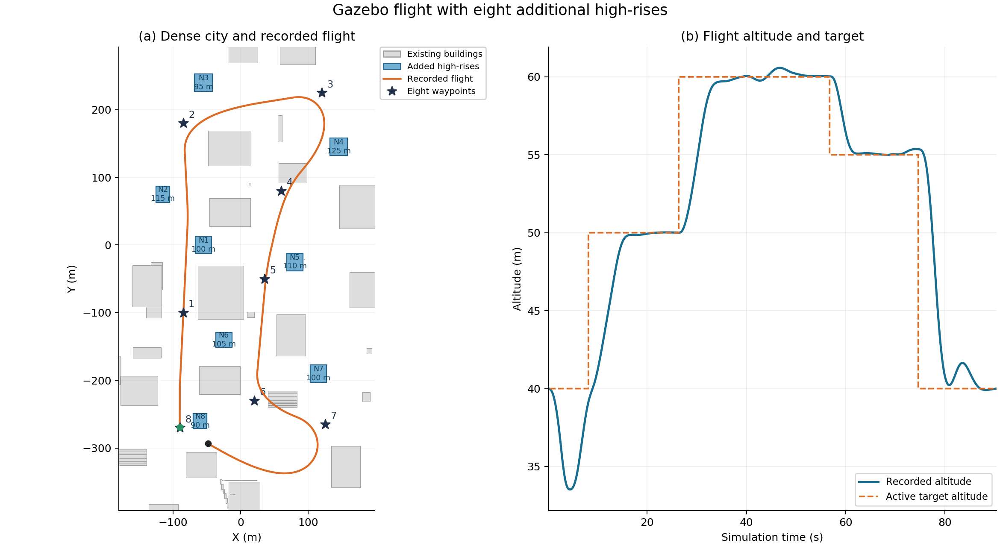
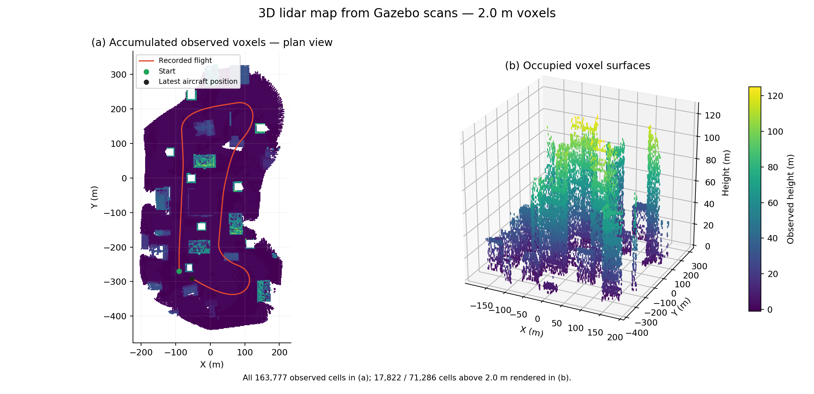

# 高楼增密城市飞行

在 `end.world` 城市中加入 8 栋 90–125 m 高楼，分布在西侧航段、中部通道两侧及南北转弯区域。沿用原 `suav1`、32 线 LiDAR、八航点和学习排序配置。

新增建筑采用灰蓝玻璃外观与楼层条带，每栋具有一个完整实体碰撞盒；规划地图同步增加相同位置、尺寸的碰撞盒及每面 2 m 裕量，盒数由 154 增至 162。新增模型无需外部资源。布局检查确认新楼与原有物体足迹互不重叠，航点均位于建筑之外。

| 建筑 | X (m) | Y (m) | 宽 × 深 (m) | 高 (m) |
| --- | ---: | ---: | --- | ---: |
| N1 | −55 | 0 | 24 × 24 | 100 |
| N2 | −115 | 75 | 20 × 24 | 115 |
| N3 | −55 | 240 | 26 × 26 | 95 |
| N4 | 145 | 145 | 26 × 26 | 125 |
| N5 | 80 | −25 | 24 × 26 | 110 |
| N6 | −25 | −140 | 24 × 22 | 105 |
| N7 | 115 | −190 | 24 × 26 | 100 |
| N8 | −60 | −260 | 20 × 22 | 90 |

## 启动

在本仓库所属 catkin 工作区中，先停止其他场景，再执行：

```bash
source /opt/ros/noetic/setup.bash
source devel/setup.bash
roslaunch motion_primitives_planning terminal_recovery_end_world_dense_lidar.launch paused:=false
```

Gazebo 显示增密城市，RViz 显示实时扫描、飞行轨迹和 2 m 彩色体素地图。地图容量为 200,000 格，可通过 `voxel_resolution`、`max_voxels` 调整。原入口 `terminal_recovery_end_world_lidar.launch` 保留较稀疏的城市，用于对照。

## 完整航线测试

| 项目 | 实测结果 |
| --- | ---: |
| 八航点完整循环 | 通过，记录至 90.432 s |
| 到点切换门限 | 全部通过 |
| 规划状态 | 902 次 RECOVERY_VERIFIED |
| 最小物理包围盒净空 | 11.563 m |
| 最小膨胀包围盒净空 | 9.098 m |
| 物理盒 / 裕量侵入样本 | 0 / 0 |
| 原始 / 世界坐标扫描帧 | 452 / 452 |
| 原始回波点 | 3,410,280 |
| 最后保存的体素数 | 163,777 |
| 容量淘汰 | 0 |

净空按实测飞机参考点到建筑包围盒计算。所有高楼的 Gazebo 加载位姿与配置一致，8 栋均记录到侧面或屋顶的 LiDAR 回波。建图检查同时验证了坐标系、网格对齐、32 线扫描和地图增长。最后地图对应 89.808 s，最后扫描对应 90.408 s，地图按定时周期发布。





体素图仅使用实际扫描形成的地图；三维视图按图注抽稀显示，原始数据保持完整。规划器继续使用同步生成的已知障碍地图，建图接口见 [LiDAR 说明](../lidar_voxel_map/README.md)。

实测原始记录位于 [evidence/flight1](evidence/flight1)：`flight` 保存里程计、规划状态及任务配置，`mapping` 保存点云统计与体素快照，`towers` 保存逐栋加载位姿和扫描命中数。布局预检查见 [layout_checks.json](layout_checks.json)，生成器验证见 [generator_validation.json](generator_validation.json)。这些场景接入数据独立于论文方法比较。

## 论文中的系统验证

论文已加入 “Gazebo Closed-Loop Validation in a Dense Urban Environment” 小节。图 7 为 Gazebo 和 RViz 的真实窗口截图：上图展示增密城市，下图展示雷达体素地图与红色实际航迹。截图采自相同配置的独立复现运行，在八航点循环完成后暂停仿真并直接保存原生窗口，分辨率均为 1920 × 1043。采集说明、运行记录及视角配置见 [interface_capture/capture_manifest.json](interface_capture/capture_manifest.json)。

图 8 为实际航迹、雷达体素、高度与滚转、障碍净空的四联数据图。该图及表 III 继续使用 `evidence/flight1` 原始记录。图像数据与显示抽稀方式见 [paper_figure_data.json](paper_figure_data.json)，表格数据来源见 [paper_validation_data.json](paper_validation_data.json)。

论文表格采用完成第八航点并切回首点的实际消息时刻 **90.408 s**；上方记录结束时刻 **90.432 s** 是最后一条里程计，两者分别保留。正文说明了运行版的 406 个主候选、航点门限、简化动力学及已知地图规划输入。此单次系统验证与原有多地图方法对照分别报告。

在仓库根目录执行 `python3 paper/create_gazebo_figure.py` 可重绘论文图；城市验证正文、图注和表格已统一放入 `paper/main.tex`，搜索 `BEGIN SECTION: gazebo_validation` 即可定位。

## 修改建筑与复现

在仓库根目录编辑 `motion_primitives_planning/launch/config/end_city_dense_buildings.json`，然后依次生成建筑与雷达场景：

```bash
python3 motion_primitives_planning/scripts/generate_dense_city.py \
  --base-world simple-airplane/simple_airplane_gazebo/worlds/end_city.world \
  --base-task motion_primitives_planning/launch/config/task_end_city.yaml \
  --buildings motion_primitives_planning/launch/config/end_city_dense_buildings.json \
  --output-world simple-airplane/simple_airplane_gazebo/worlds/end_city_dense.world \
  --output-task motion_primitives_planning/launch/config/task_end_city_dense.yaml \
  --manifest docs/recovery/dense_city/generation_manifest.json

python3 motion_primitives_planning/scripts/generate_lidar_world.py \
  --base-world simple-airplane/simple_airplane_gazebo/worlds/end_city_dense.world \
  --output simple-airplane/simple_airplane_gazebo/worlds/end_city_dense_lidar.world
```

生成器保留原场景元素、飞机和航点，并拒绝覆盖输入文件。建筑布局变化后需重新检查通道与试飞。复现本轮航迹图：

```bash
python3 docs/recovery/dense_city/plot_dense_flight.py \
  --trace docs/recovery/dense_city/evidence/flight1/flight/observations.json.gz \
  --task-config docs/recovery/dense_city/evidence/flight1/flight/task_config.yaml \
  --buildings motion_primitives_planning/launch/config/end_city_dense_buildings.json \
  --output /tmp/dense_city_flight.png
```
