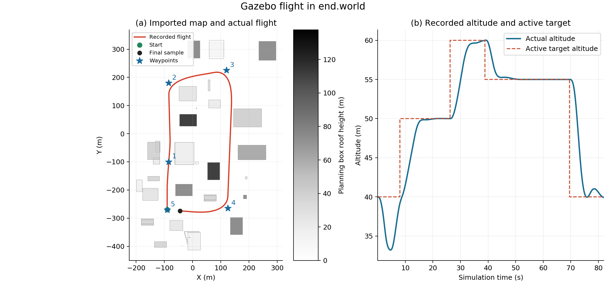

# end.world 城市飞行测试

将用户提供的 `/home/tan/FW_mp/end.world` 接入运行版规划器，使用原有 **suav1** 飞机、动力学插件、机载相机和学习排序网络。原文件未修改。

## 场景接入

原场景包含 55 个模型，使用本机 `~/.gazebo/models` 中的城市资源。Gazebo 保存的 `<state>` 包含编辑后的位置和缩放；导入采用 Gazebo 实际加载态，保留该状态，避免把建筑放回编辑前的位置或重复应用缩放。

规划地图包含 154 个轴对齐包围盒：146 个来自原碰撞组件的世界坐标包围盒，另 8 个用于 mcity 地面及建筑连通部件。独立核对确认：55 个模型的加载位置、缩放和碰撞边界不变，mcity 的全部 7,333 个三角面均被相应包围盒覆盖。每面增加 2 m 规划裕量，原始网格用于 Gazebo 显示和物理碰撞，包围盒用于规划器的碰撞检查及网络几何输入。

本次采用已知静态地图。三个垃圾箱和七个路锥设为静态，使地图与仿真保持一致；其他场景几何保留。飞机初始位置为 `(-90, -270, 40)`，航向朝北，按五个航点循环飞行，目标高度依次为 40、50、60、55、40 m。该场景高度范围设为 5–160 m，爬升/下降角仍为 20°、滚转上限仍为 35°，到点高度容差仍为 3 m。

当前默认路线已扩展为八航点，在原第 3、4 点之间增加 `(60,80,60)`、`(35,−50,60)`、`(20,−230,55)` 三个城市中部目标点。带 LiDAR 的八航点循环实测通过，结果见 [新增航线与建图记录](../lidar_voxel_map/README.md)。下方保留最初五航点路线的测试数据；原任务配置随历史证据保存。

## 原五航点飞行结果

| 项目 | 实测值 |
| --- | ---: |
| 五航点完整循环 | 通过 |
| 记录结束仿真时间 | 82.032 s |
| 里程计样本 | 5,127 |
| 规划状态 | 820 次 RECOVERY_VERIFIED |
| 最小物理包围盒净空 | 10.628 m |
| 最小膨胀包围盒净空 | 7.753 m |
| 记录高度范围 | 33.210–60.017 m |
| 记录空速范围 | 13.387–18.536 m/s |
| 最大绝对航迹角 | 16.159° |
| 最大绝对滚转角 | 33.978° |

净空由实测飞机参考点到规划包围盒计算；没有记录到包围盒或膨胀裕量侵入。所有航点切换均满足原水平和高度门限。本次为一条指定航线的接入验证，结果单独保存，不并入论文方法比较。



原始轨迹及状态在 [evidence/flight](evidence/flight)，几何核对见 [geometry_validation.json](geometry_validation.json)。`setup_attempts` 保留了两次尚未开始飞行的启动中断：测试管理脚本错误识别观察器节点名称，随后已修正。成功运行的墙钟时间包含初始暂停等待，飞行时间以仿真时间为准。最终发布 world 仅在已测版本上增加 GUI 跟随视角；其余内容逐项一致。

## 飞机显示修复

此前只显示方块，是原生 SDF 中的 `package://simple_airplane_description/meshes/simple_airplane.dae` 未被 Gazebo 解析，机身 mesh 缺失，而相机外壳仍正常显示。

运行场景改用 `model://simple_airplane_description/meshes/simple_airplane.dae`，并在 description 包导出 Gazebo 模型搜索路径。网格文件、模型比例和飞行接口均沿用原版。新场景已验证机身碰撞边界非零，Gazebo server/client 不再出现该机身的 `Failed to find mesh file` / `No mesh specified` 错误。旧记录中的 world 哈希对应修复前版本，未追改历史证据。

## 启动

先停止其他演示，在本仓库所属 catkin 工作区根目录执行：

```bash
source /opt/ros/noetic/setup.bash
source devel/setup.bash
roslaunch motion_primitives_planning terminal_recovery_end_world.launch paused:=false
```

Gazebo 默认跟随 `suav1`，RViz 显示同一规划地图和候选轨迹。要观察全城，可取消 Gazebo 的跟随视角。任务持续循环；在启动终端按 Ctrl+C 结束。

机载 3D LiDAR 版本使用 `terminal_recovery_end_world_lidar.launch`，在同一场景中显示由扫描回波累积的体素地图。配置和完整航线测试见 [LiDAR 建图说明](../lidar_voxel_map/README.md)。

城市 mesh/材质资源使用本机已有的 `~/.gazebo/models`，并未将整套外部模型复制到仓库。换机器时需一并迁移 end.world 引用的模型目录。原始 world 的压缩副本及 SHA 保存在证据目录和 [导入清单](import_manifest.json)。

## 代码和检查

运行版新增箱体参数加载、碰撞检测、网络 SDF 查询及 RViz 可视化。缺失尺寸、非法数值或无效裕量会报错，避免静默忽略建筑。切换旧场景时先清零箱体数量。新增 6 项箱体测试、原 6 项盘旋爬升测试、4 项观察器测试全部通过；冻结的论文源码、网络权重及历史实验保持不变。

```bash
catkin_make motion_primitives_test runtime_box_test runtime_vertical_test -j2
rostest motion_primitives_planning runtime_box.test
rostest motion_primitives_planning runtime_vertical.test
python3 src/Two-phase-motion-planning/motion_primitives_planning/test/test_end_world_observer.py
```

观察器 `motion_primitives_planning/scripts/verify_end_world.py` 在启动仿真前运行，使用同一 `ROS_MASTER_URI`，只读记录，不发送飞行命令。示例：

```bash
repo="$PWD/src/Two-phase-motion-planning"
python3 "$repo/motion_primitives_planning/scripts/verify_end_world.py" \
  --task-config "$repo/motion_primitives_planning/launch/config/task_end_city.yaml" \
  --output-dir /tmp/end-city-check --sim-seconds 180 --wall-seconds 300 --stop-after-cycle
```

重新生成导入文件时，先用 `inspect_gazebo_world.cpp` 提取原 world 的 Gazebo 碰撞边界，用 `export_gazebo_mesh.cpp` 导出 mcity 三角面，再调用 `import_end_world.py --help` 所列参数。两个独立工具可通过 `g++ <source.cpp> -o <tool> $(pkg-config --cflags --libs gazebo)` 编译，检查 world 时使用独立的 `GAZEBO_MASTER_URI`。导入脚本拒绝覆盖输入文件。

复现图像：

```bash
python3 docs/recovery/end_world/plot_end_world.py \
  --trace docs/recovery/end_world/evidence/flight/observations.json.gz \
  --task-config motion_primitives_planning/launch/config/task_end_city.yaml \
  --output /tmp/end_world_flight.png
```
