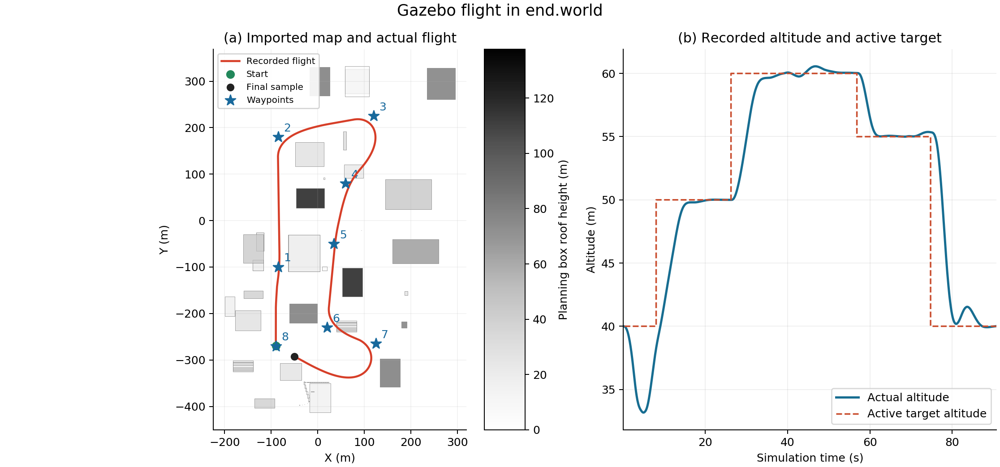
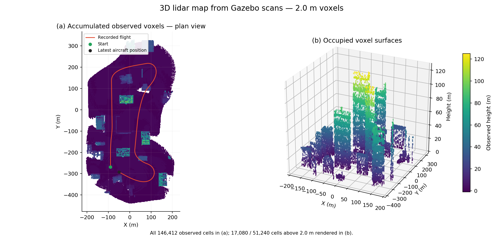

# 机载 3D LiDAR 与 RViz 体素地图

在原 `suav1` 机身上安装多线激光雷达，使用 Gazebo 射线与场景碰撞网格的真实交点生成点云。地图随飞机飞行逐步累积，体素颜色表示高度。

新增 8 栋高楼的密集城市场景使用 `terminal_recovery_end_world_dense_lidar.launch`，建筑位置及本轮结果见 [高楼增密城市飞行](../dense_city/README.md)。下方保留原城市场景的配置和测试记录。

## 传感器与建图流程

| 参数 | 配置 |
| --- | --- |
| 扫描 | 水平 512 点 × 垂直 32 线 |
| 视场 | 水平 360°，垂直 −40° 至 +20° |
| 距离 | 1–120 m |
| 扫描频率 | 5 Hz 仿真时间 |
| 安装位姿 | 相对 `suav1/base_link` 为 `(0, 0, 0.15)` m，无旋转 |
| 点云字段 | `x, y, z, intensity`，PointCloud2 |
| 默认体素 | 2 m，最多 200,000 格 |

`gazebo_ros_3d_lidar` 按实际射线角度计算回波端点，并使用当前扫描的测量时间戳。无回波及最大量程返回不会生成占据点。

`lidar_voxel_map.py` 缓存点云和里程计，根据扫描时间插值位置、以 SLERP 插值姿态，再结合雷达外参将点云转换到 `world`。缺少后续位姿时等待，超时、时间间隔过大或过旧的扫描会丢弃并计数。地图按体素索引去重；时间回退会清空旧地图，达到容量后淘汰最久未更新的体素。

定位使用仿真里程计。本模块累积的是**已观测回波端点占据体素**，没有自由空间射线清空或 SLAM 优化；当前规划器仍使用已有的障碍地图，体素地图用于传感器建图与 RViz 显示。地图发布配置为墙钟 2 Hz，实际频率受转换与发布开销影响。

## ROS 接口与 RViz

| Topic | 类型 | 坐标系 / 内容 |
| --- | --- | --- |
| `/suav1/lidar/points_raw` | `sensor_msgs/PointCloud2` | `suav1/lidar`，原始扫描 |
| `/suav1/lidar/points` | `sensor_msgs/PointCloud2` | `world`，按时间对齐的当前扫描 |
| `/suav1/voxel_map` | `visualization_msgs/Marker` | `world`，彩色 `CUBE_LIST` |
| `/suav1/voxel_map_points` | `sensor_msgs/PointCloud2` | `world`，累积占据格中心 |
| `/suav1/voxel_map/status` | `std_msgs/String` | JSON：帧数、点数、体素数、丢弃与淘汰计数 |

RViz 固定帧为 `world`，默认启用 **3D Voxel Map**、**Current 3D LiDAR Scan**、飞机模型和目标点。规划器包围盒与候选轨迹默认关闭，可按需打开。`robot_state_publisher` 发布 `suav1/base_link → suav1/lidar` 固定变换。

## 编译和启动

在本仓库所属 catkin 工作区根目录执行：

```bash
source /opt/ros/noetic/setup.bash
catkin_make -j2 -DCATKIN_WHITELIST_PACKAGES="motion_primitives_planning;simple_airplane_plugins;simple_airplane_gazebo;simple_airplane_description"
source devel/setup.bash
roslaunch motion_primitives_planning terminal_recovery_end_world_lidar.launch paused:=false
```

先停止其他 Gazebo 演示，再启动此入口。城市 mesh 与材质仍使用本机已有的 `~/.gazebo/models`。Gazebo 跟随原 `suav1`，RViz 展示扫描形成的地图。

分辨率与容量可调整，例如：

```bash
roslaunch motion_primitives_planning terminal_recovery_end_world_lidar.launch \
  paused:=false voxel_resolution:=1.0 max_voxels:=300000
```

更小体素会增加内存、发布与绘制开销。通过 `/suav1/voxel_map/status` 查看当前地图格数及 `evicted_voxels`；没有该字段表示尚未发生容量淘汰。

## 验证记录

原五航点外环完成一轮飞行，观测到 409 帧扫描、2,458,061 个点；最后保存的 2 m 地图包含 **151,701 个体素**，未触发容量淘汰。32 条垂直线、点云与地图坐标系、体素网格对齐、地图增长及无最大量程伪占据壳均通过检查，见 [city_full_map](evidence/city_full_map/mapping/result.json)。保存的地图消息频率约为 1.28 Hz（仿真时间）。

1 m / 100,000 格的早期配置也完成同一外环，但达到容量上限并触发淘汰；原始结果保留在 [city_flight](evidence/city_flight/mapping/result.json)。两组运行的任务配置均随各自证据保存。

**城市中部八航点验证通过。** 当前任务在原第 3 点与第 4 点之间加入以下目标点：

| 当前编号 | X (m) | Y (m) | 高度 (m) |
| --- | ---: | ---: | ---: |
| 4 | 60 | 80 | 60 |
| 5 | 35 | −50 | 60 |
| 6 | 20 | −230 | 55 |

八点循环在 90.8 s 时完成，905 次规划状态均为 `RECOVERY_VERIFIED`，所有到点切换满足原门限。实测飞机参考点到原始建筑包围盒的最小距离为 12.453 m，到膨胀包围盒的最小距离为 9.591 m；没有包围盒或裕量侵入。航线从北侧进入城市中轴，穿过两栋高层建筑之间的通道，再向南返回。

本轮共观测到 453 帧原始点云及 453 帧世界坐标点云，2,766,361 个回波点。最后保存的 2 m 地图有 **146,412 个体素**，没有容量淘汰。地图定时发布，最后一张地图与状态对应 89.608 s，早于最后一帧扫描 90.608 s。飞行及建图记录独立保存在 [city_center_route](evidence/city_center_route)，两项验收均通过。几何候选检查见 [waypoint_geometry.json](waypoint_geometry.json)，其中中心连线净空与这里的实飞净空分别记录。





7 项建图单测覆盖外参和姿态变换、扫描时刻插值、等待后续位姿、负坐标索引、非有限点过滤、重置清图、位姿间隙/超时/容量限制，以及四元数符号一致性。隔离 ROS 冒烟测试验证了 PointCloud2 解码、消息发布和清图行为，记录见 [mapper](evidence/mapper/smoke_result.json)。

移动传感器标定中，8 帧点云均与 Gazebo 当前测量时间匹配，频率为 5 Hz，地面/墙面端点最大误差约 `1.68e-6 m`；错误使用上一帧时间会产生约 0.4 m 的 P99 误差。空场景标定连续 8 帧均为空点云，没有伪造最大量程回波。见[移动标定](evidence/sensor/calibration_result_moving.json)与[空云标定](evidence/sensor/calibration_result_empty.json)。

单独运行建图单测：

```bash
python3 src/Two-phase-motion-planning/motion_primitives_planning/test/test_lidar_voxel_map.py
```

## 体素图复现

原五航点外环图保留为 [lidar_full_map.png](lidar_full_map.png)。

在仓库根目录执行：

```bash
python3 docs/recovery/lidar_voxel_map/plot_lidar_voxels.py \
  --input docs/recovery/lidar_voxel_map/evidence/city_center_route/mapping/snapshots.npz \
  --output /tmp/lidar_center_map.png --max-cubes 18000
```

绘图只读取保存的扫描地图，不读取先验建筑几何。俯视图显示全部记录体素；三维视图按图注进行确定性抽稀，以控制渲染量，原始地图不变。
