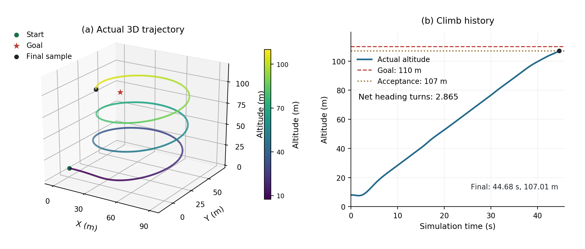

# Gazebo 盘旋爬升修复与验证

运行版规划器增加当前高度附近的细分候选，解决到达高空航点前持续平飞盘旋的问题。爬升可以跨越多圈：每个规划周期重新选择一段转弯爬升轨迹，直到同时满足水平距离和高度到点条件。

## 原因与修改

修复前，在第二航点 `(350, 0, 24)` 附近，飞机停留在约 8.684 m 高度。原高度采样包含 1、8.667、16.333、24 m 等层。下一上升层直接跳到 16.333 m；对应恒定控制在 3 s 预测中产生约 33.7° 爬升角，超过 20° 上限，29 个航向候选全部被排除。平飞转弯候选持续被选中，因此增加盘旋时间也不能积累高度。

`RuntimeMotionPrimitives::generate_library()` 保留原高度层，补充当前高度及三档相对升降高度：

\[
h,\qquad h\pm d\tan(\alpha\gamma_{\max}),\qquad
\alpha\in\{1/16,1/8,1/4\}.
\]

升、降分别使用对应角度上限，候选高度经过原高度边界裁剪和去重。默认配置下，新增高度增量约为 ±1.015、±2.030、±4.068 m，主候选数由最多 203 增至最多 406。`vertical_num=1` 的单层模式保持原行为。规划器仍逐条预测并检查飞行包线、碰撞和终端续飞；K=12、20° 爬升上限、35° 滚转上限、3 m 高度到点容差及网络权重均保持原值。

新增候选提供小幅、可连续执行的爬升控制。没有设置必须一圈到达的条件，也没有固定盘旋圈数；所需圈数由高度差和在线轨迹选择决定。

运行入口 `motion_primitives_test.cpp` 使用新增的 `src/runtime_motion_primitives.h`。论文训练、基准与历史测试继续使用冻结的 `src/motion_primitives.h`，其 SHA-256 为 `a08773a2f3c79a9f3f481590b8d197ff933f01b1670ccf0e5de31293b588fc73`。本目录记录运行版修复结果，论文中的 203 候选实验及模型权重未修改。

## Gazebo 实测

所有运行使用 Gazebo Classic 的飞机动力学插件、学习排序及原有到点条件。时间为记录结束时的仿真时间；三航点路线在最后一次航点切换后结束采集。

| 场景 | 仿真时间 | 结果 |
| --- | ---: | --- |
| 修复前三航点 | 100.10 s | 停留第二目标，末段高度约 8.684 m |
| 修复后三航点 | 31.42 s | 三航点全部通过，第二目标切换时高度 21.147 m |
| 修复后三航点重复 | 31.78 s | 三航点全部通过，第二目标切换时高度 21.528 m |
| 70 m 目标 | 29.50 s | 达到 67.286 m；累计净航向变化 1.830 圈 |
| 110 m 目标 | 44.68 s | 达到 107.012 m；累计净航向变化 **2.865 圈** |

多圈测试为无障碍场景，目标水平位置 `(50, 0)`，初始高度约 8 m。110 m 测试将高度上界设为 120 m，最大实测爬升角 12.469°、滚转角约 35°，空速范围 13.309–15.896 m/s，达到目标时水平误差 22.74 m。累计圈数按相邻航向角差展开后求和计算。70 m 测试达到原有到点条件，但未达到预设的“至少两整圈”测试条件，故其原始 `passed` 字段保留为 `false`；110 m 测试满足该条件。



图中轨迹、目标坐标和圈数均取自原始观测。复现图像：`python3 plot_multiturn_climb.py --input evidence/multiturn_110/observations.json.gz --output multiturn_climb.png`。

三航点两次运行的最小膨胀障碍净空分别为 0.000882 m 和 0.002390 m，接近边界；这些数值为 50 Hz 飞机参考点到解析障碍的采样距离。两次分别出现 47/311、41/315 次 `BUDGET_EXHAUSTED`，110 m 测试为 5/444 次。全部记录中网络均正常加载。该修复验证了高度死锁解除和跨圈爬升，障碍净空及预算耗尽情况一并保留在原始证据中。

## 编译与运行

在 catkin 工作区根目录执行：

```bash
source /opt/ros/noetic/setup.bash
catkin_make -j2 -DCATKIN_WHITELIST_PACKAGES="motion_primitives_planning;simple_airplane_plugins;simple_airplane_gazebo;simple_airplane_description"
source devel/setup.bash
roslaunch motion_primitives_planning terminal_recovery_learned.launch paused:=false
```

观察 110 m 多圈爬升演示时，先停止上一场景，再运行：

```bash
roslaunch motion_primitives_planning terminal_recovery_multiturn.launch paused:=false
```

该演示打开 Gazebo 和 RViz。其全部 54 项 ROS 参数及 world 文件与通过测试的 110 m 场景一致，见 [入口核对](entry_verification.json)。默认三航点场景仍使用原 80 m 高度上界。重新编译后需要重启已有节点，正在运行的进程不会自动加载新程序。

单航点演示沿用原循环任务逻辑，达到目标后继续绕该目标飞行；观察脚本在首次达到到点条件时结束采集。

## 回归检查与复现

新增 6 项回归检查全部通过，覆盖：实测盘旋状态选择爬升候选、粗上升候选仍被原约束拒绝、大高度差、边界裁剪与去重、高度到点容差，以及独立 RK4 动力学下三个初始盘旋相位的脱困。XML 与编译日志位于 [unit_tests](unit_tests)。

```bash
catkin_make runtime_vertical_test -j2
rostest motion_primitives_planning runtime_vertical.test
```

可移植观察脚本在独立 ROS/Gazebo 端口运行并记录轨迹，不向其他仿真实例发控制命令。将下面的工作区路径替换为本机路径：

```bash
workspace=/path/to/two_phase_ws
source "$workspace/devel/setup.bash"
evidence_dir="$(rospack find motion_primitives_planning)/../docs/recovery/runtime_vertical_fix"
python3 "$evidence_dir/gazebo_regression.py" \
  --workspace "$workspace" --output-dir /tmp/vertical-regression --tag course \
  --port 11418
python3 "$evidence_dir/gazebo_regression.py" \
  --workspace "$workspace" --output-dir /tmp/vertical-regression --tag climb110 \
  --case multiturn --scenario-dir "$evidence_dir/scenarios/multiturn_110" \
  --goal-height 110 --port 11418
```

每次使用新 tag；端口及下一端口须空闲。两条命令顺序运行。`evidence/` 保存五次运行的结果、无损压缩的轨迹及日志，`diagnosis/` 保存实测状态和候选诊断。修复前版本为 `c925f9a`；原始二进制哈希、文件哈希和采集记录见 [MANIFEST.json](MANIFEST.json)。
