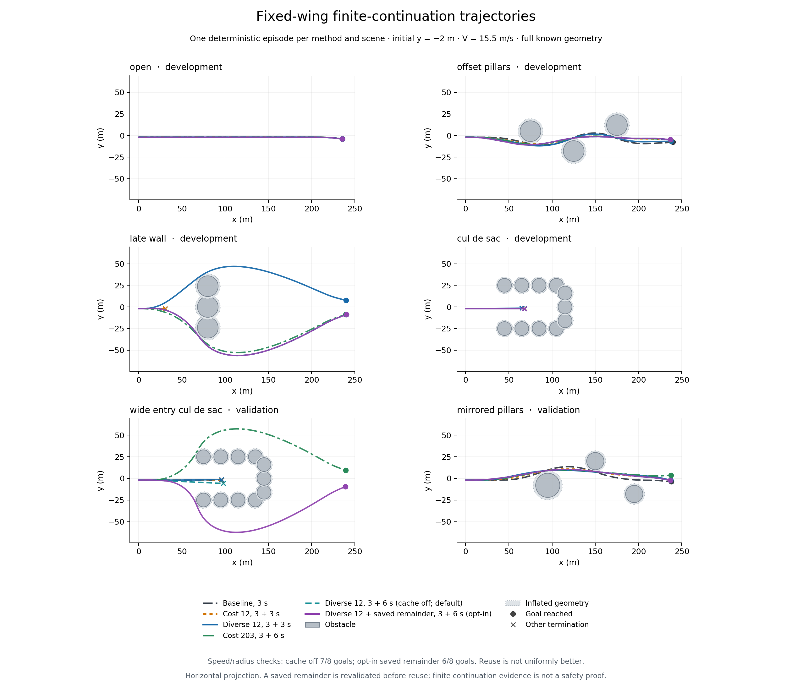
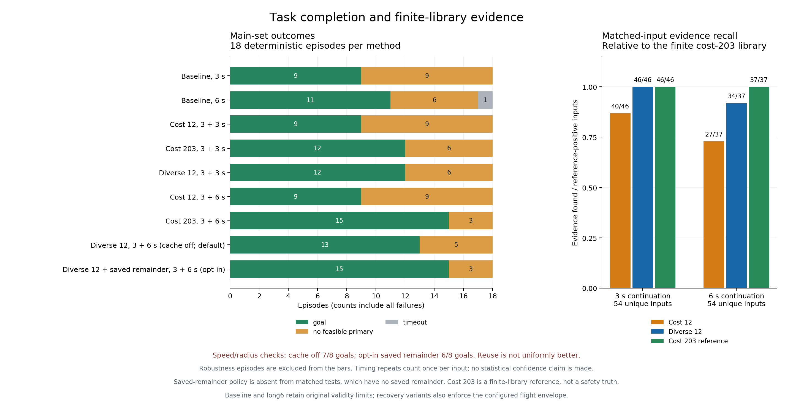

# 第二阶段实验结果（2026-10-30）

本轮实现多方向候选调度，以及可选的剩余控制序列重验与执行。原有19项和新增模块21项测试全部通过，共40项；194回合与972次匹配输入测量完成，数据审计没有发现缺组、重复决策变化或有限库参照矛盾。两个Gazebo入口设置均完成8秒集成观察，约10 Hz发布状态；该观察不等于整条航线无碰撞验证。

## 主实验：每种方法18回合

以下6地图、3横向初态和地图几何完全相同，保留全部失败。

| 方法 | 完成 | 无可行主段 | 超时 | 平均选择耗时 ms | P95 ms |
|---|---:|---:|---:|---:|---:|
| baseline | 9/18 | 9 | 0 | 2.08 | 3.29 |
| long6 | 11/18 | 6 | 1 | 3.89 | 5.93 |
| cost12_h3 | 9/18 | 9 | 0 | 2.66 | 5.68 |
| cost203_h3 | 12/18 | 6 | 0 | 3.22 | 11.79 |
| diverse12_h3 | 12/18 | 6 | 0 | 2.54 | 5.48 |
| cost12_h6 | 9/18 | 9 | 0 | 3.47 | 8.25 |
| cost203_h6 | 15/18 | 3 | 0 | 4.37 | 19.91 |
| diverse12_h6 | 13/18 | 5 | 0 | 3.11 | 7.75 |
| diverse12_h6_cache | 15/18 | 3 | 0 | 3.02 | 7.43 |

耗时聚合了不同方法访问的不同状态和回合长度，不能作为相同计算工作的加速比。原baseline保留旧模型阈值，和recovery系列之间还存在飞行包线过滤差异；严格候选排序比较应在cost12/cost203/diverse12之间进行。

- 同样3秒后续、12候选：多方向调度从9/18提升到12/18，在横向墙体不再遗漏必要转向。
- 6秒后续、多方向调度：13/18；打开剩余方案复用后15/18，与这批任务上的完整候选检查完成数相同。
- 入口后移30米的死胡同：完整6秒后续检查3/3，多方向6秒1/3，加入剩余方案复用3/3。缓存主实验仅6个周期真正复用，因此改进并不是持续延长缓存时域造成的。
- 原来的近入口死胡同：所有方法仍为0/3。只能说当前有限候选和已测设置没有找到完成方案，不能据此宣称该初态在物理上无解。

## 附加速度/观测范围设置：每种方法8回合

| 方法 | 完成 | 无可行主段 | 超时 |
|---|---:|---:|---:|
| cost12_h6 | 4/8 | 4 | 0 |
| cost203_h6 | 8/8 | 0 | 0 |
| diverse12_h6 | 7/8 | 1 | 0 |
| diverse12_h6_cache | 6/8 | 1 | 1 |

缓存复用在这里并非单调改善：17 m/s、120米理想观测球的错列柱体出现一次30秒超时；其余也有无可行主段失败。新入口默认启用多方向调度、关闭缓存复用。需要复现实验时显式添加 `reuse_verified_plan:=true`，不能把主矩阵15/18作为默认模式结果。

## 相同输入上的候选证据覆盖

972行是108个输入配置×3方法×3次计时，不是972个独立场景。每个方法收到相同完整状态、地图、目标和上一控制；顺序轮换。以相同后续时域的cost203作为有限基元库参照，重复计时先合并。

| 后续时长 | 配置数 | 参照有证据的配置 | cost12找到 | diverse12找到 |
|---|---:|---:|---:|---:|
| 3秒 | 54 | 46 | 40/46 | 46/46 |
| 6秒 | 54 | 37 | 27/37 | 34/37 |

多方向调度提高有限库证据的找到比例，但平均检查次数也可能增加；它不是免费提速。完整逐场景配对耗时、积分步数和代价差见[机器可读分析](recovery_v2_analysis.json)与[完整审计表](recovery_v2_analysis.md)。有限库参照不是可恢复性真值。

## 复现与证据

本次非缓存168回合的结局和步数与加入缓存之前逐项一致。计算前关闭本任务Gazebo进程；没有CPU绑核或实时调度，耗时仍受机器负载影响。随后单独运行Gazebo集成检查。

- [回合结局](recovery_v2_episodes.csv)、[每周期状态和计数](recovery_v2_plans.csv)、[轨迹](recovery_v2_paths.csv)、[场景](recovery_v2_scenarios.csv)
- [匹配输入测量](recovery_v2_matched.csv)、[源文件校验和运行设置](manifest.json)
- [原测试](tests_baseline.txt)、[新模块测试](tests_recovery.txt)
- [默认入口集成记录](gazebo_v2_summary.json)、[开启复用的集成记录](gazebo_v2_cache_summary.json)

这些都是同模型、理想观测的开发诊断。尚未证明一般未知环境安全或统计显著性，也未加入学习模型。下一步应定位高空速/有限观测下复用超时的原因，补充独立动力学、延迟与真实观测模型，再决定学习候选生成和论文主张。
